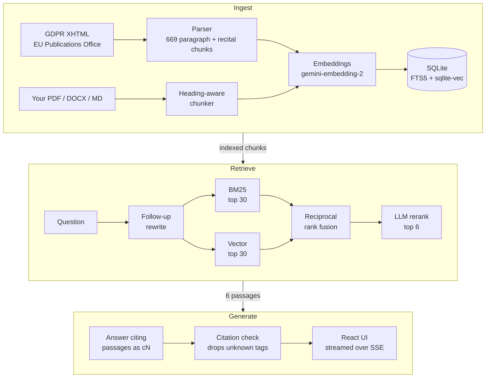

<div align="center">

# gdpr-rag

**Ask the GDPR anything. Every claim links to the article it comes from.**
**Upload a privacy policy and get an Article 13/14 gap report with verbatim evidence.**

[](https://github.com/EFaridRahimli/gdpr-rag/actions/workflows/ci.yml)


[](LICENSE)


</div>

An end-to-end retrieval-augmented generation pipeline over the EU General Data Protection
Regulation, built to be measured rather than demoed. Retrieval, answers and the compliance check
each have an eval; every pipeline choice below was picked by a number, and CI fails if retrieval
regresses. It runs on a laptop: one SQLite file, no Docker, no GPU. Only model calls leave the
machine, through your own [OpenRouter](https://openrouter.ai) key.

## Results

| What | Metric | Score |
|---|---|---|
| Retrieval | Right paragraph in the top 5 (50 questions) | **1.00** recall@5, 0.96 MRR |
| Answers | Every claim supported by its cited source (LLM judge) | **0.94** faithful, 0.98 citations correct |
| Compliance check | Planted gaps found in 3 synthetic policies | **8 / 8**, with 1 of 24 covered items wrongly flagged |

Methodology and the full tables are in [Evaluation](#evaluation), including what these numbers do not show.

## Features

- **Grounded answers.** Answers stream in with `[c1]`-style tags that render as article links.
  The backend drops any citation to a passage that wasn't retrieved, and an answer left without a
  valid citation becomes "not found" instead of a guess.
- **The exact passage, one click away.** Citations open the article paragraph in a side panel,
  with a link to the official text on EUR-Lex.
- **Follow-up questions.** "And what about telling the people affected?" is rewritten into a
  standalone question before retrieval, so it still finds Art. 34.
- **Your documents.** Upload PDF, DOCX, Markdown or text. Search the GDPR, your documents, or both.
- **Compliance check.** A privacy policy is audited against the 14 items Articles 13 and 14
  require: Covered, Partial, Missing or Not applicable, each with quotes and a fix. Quotes are
  checked word for word against the document, so the model can't invent coverage.
- **Local and private by default.** Chats, documents and reports live in `data/gdpr.db` on your
  machine. The API binds to `127.0.0.1` and never returns your key.

<table>
  <tr>
    <td width="50%"></td>
    <td width="50%"></td>
  </tr>
  <tr>
    <td align="center">Cited answer with the source passage open</td>
    <td align="center">Article 13/14 report for an uploaded policy</td>
  </tr>
</table>

## Quickstart

You need [uv](https://docs.astral.sh/uv/getting-started/installation/) and an
[OpenRouter API key](https://openrouter.ai/keys). Node is not needed; the built frontend is in the repo.

```bash
git clone https://github.com/EFaridRahimli/gdpr-rag && cd gdpr-rag
cp .env.example .env          # paste your key, or add it later on the Settings page
uv run gdpr-rag ingest        # download, chunk and embed the GDPR (a minute or two, ~$0.03)
uv run gdpr-rag serve         # http://localhost:8000
```

`uv` installs the right Python version and every dependency on first run.
A question costs roughly $0.002 with the default models (estimated from OpenRouter list prices).

## How it works



1. **Chunking.** The GDPR is parsed from the official Journal XHTML into one chunk per article
   paragraph (`Art. 6(1)`) and one per recital. Paragraphs over 350 words, such as the 26
   definitions in Art. 4, are split per lettered point with the lead-in repeated, so every chunk
   is a citable unit. Uploads are split along their headings.
2. **Hybrid retrieval.** FTS5 keyword search and sqlite-vec nearest neighbours each return 30
   candidates, fused with reciprocal rank fusion (a few lines, no library).
3. **Reranking.** The answer model picks the 6 most relevant of the 30 candidates.
4. **Grounded generation.** The model sees only those 6 passages and must cite one for every
   sentence. Unknown tags are removed, and an uncited answer becomes "not found".

## Evaluation

All eval data is committed in [`eval/`](eval) and every number regenerates with one command.

### Retrieval: `uv run gdpr-rag eval retrieval --bakeoff`

50 synthetic questions, each written by `claude-sonnet-5.5` from one sampled article paragraph.
The questions were not reviewed by hand. Instead, a code check rejects any question that copies
4 or more consecutive words from its passage, and a second model pass removes ambiguous,
unanswerable or duplicate ones. A hit means the question's source paragraph is retrieved.

| Mode | Embedding model | Recall@5 | Recall@10 | MRR |
|---|---|---|---|---|
| BM25 only | — | 0.18 | 0.28 | 0.16 |
| Vector only | openai/text-embedding-3-large | 0.84 | 0.90 | 0.62 |
| Vector only | qwen/qwen3-embedding-8b | 0.86 | 0.94 | 0.72 |
| Vector only | mongodb/voyage-4-large | 0.92 | 1.00 | 0.77 |
| Vector only | google/gemini-embedding-2 | 0.98 | 1.00 | 0.78 |
| Hybrid (BM25 + vector) | google/gemini-embedding-2 | 0.68 | 0.96 | 0.44 |
| Hybrid + local cross-encoder | google/gemini-embedding-2 | 0.24 | 0.58 | 0.18 |
| **Hybrid + LLM rerank** | **google/gemini-embedding-2** | **1.00** | **1.00** | **0.96** |

All 17 configurations are in [`eval/results/retrieval.md`](eval/results/retrieval.md).
CI re-runs the default configuration and fails if recall@10 drops below the committed baseline.

### Answers: `uv run gdpr-rag eval answers`

The same 50 questions answered by `claude-haiku-5.5` and judged by `claude-sonnet-5.5`, a
different model, so no model grades its own answers.

| Answered | Expected article cited | Faithful | Citations correct |
|---|---|---|---|
| 1.00 | 0.98 | 0.94 | 0.98 |

Faithfulness started at 0.88. The judge's reasons showed the model expanding cross-referenced
articles that weren't retrieved and generalising beyond a source's scope. Forbidding both in the
prompt raised it to 0.94, with no other change.

### Compliance check: `uv run gdpr-rag eval compliance`

Three hand-written policies (a fitness app, an online store, a recruiting platform) with 8
deliberately planted gaps, such as no right to complain, US transfers without safeguards, and
automated ranking with no explanation. The answer key in
[`eval/policies/truth.json`](eval/policies/truth.json) scores only unambiguous items.

| Planted gaps found | Covered items wrongly flagged |
|---|---|
| 8 / 8 | 1 / 24 |

Across runs the false alarms varied between 0 and 1 of 24.

### What these numbers don't show

- **The retrieval set is easy at the top.** The best configurations score 1.00, so 50 questions
  can't separate them, and every question targets a single paragraph. Questions that need several
  articles at once aren't measured.
- **Synthetic questions favour vector search.** Banning copied phrases starves BM25 by
  construction. Real users type terms like "Article 17" or "DPO", where keyword search helps,
  which is why hybrid search stays in the pipeline even though it scores lower here.
- **LLM judges are noisy.** Expect a point or two of variation between answer-eval runs.
- **Three policies is a small compliance set.** It shows the check works, not how often it's
  right on real-world policies.

## Design decisions

| Decision | Alternative considered | Why |
|---|---|---|
| LLM reranking | Local cross-encoder (`jina-reranker-v1-tiny-en`) | 1.00 vs 0.24 recall@5. The tiny model's scores were too close together to rank paraphrased questions |
| `gemini-embedding-2` | Voyage-4-large, Qwen3-8B, OpenAI 3-large | Tied with Voyage after reranking, and best without it (0.98 recall@5), so it is the safer fallback |
| API embeddings | Local `bge-small` (ONNX) | For "legitimate interest", bge-small ranked Art. 6(1)(f) 9th to 20th; API embeddings rank Art. 6(1) 2nd. The install also no longer downloads model files |
| One SQLite file | Vector database server | 669 chunks fit easily. FTS5, vectors, chats and settings live in one file with nothing to run |
| Citation check in code | Trusting the model's tags | A citation to an unretrieved passage can't reach the user. An uncited answer becomes "not found" |
| Quote check in code | Trusting the auditor model | Coverage without a verbatim quote is downgraded to Missing |
| OpenRouter, user's own key | Claude or ChatGPT subscription tokens | Anthropic's terms forbid routing consumer-plan credentials through third-party apps |
| Built frontend committed | Node required at install | Users only need `uv`. CI rebuilds and fails if the committed build is stale |

The full design record, including the questions settled before any code was written, is in [SPEC.md](SPEC.md).

## Development

```bash
uv run pytest                          # backend tests
uv run ruff check .                    # lint
cd web && npm install && npm run dev   # frontend on :5173, proxied to `gdpr-rag serve`
npm run build                          # typecheck and rebuild web/dist (commit the result)
```

| Path | Contents |
|---|---|
| `src/gdpr_rag/gdpr.py` | GDPR download and paragraph-level chunking |
| `src/gdpr_rag/store.py` | SQLite schema, FTS5 and sqlite-vec search, scope filters |
| `src/gdpr_rag/retrieve.py` | Hybrid retrieval, RRF, reranking |
| `src/gdpr_rag/answer.py` | Grounded prompt, citation check, follow-up rewriting |
| `src/gdpr_rag/docs.py` | Upload parsing and heading-aware chunking |
| `src/gdpr_rag/compliance.py` | Article 13/14 checklist and quote verification |
| `src/gdpr_rag/evals.py` | Golden-set generation and all three evals |
| `src/gdpr_rag/server.py` | FastAPI app: streaming chat, documents, reports, settings |
| `web/src/` | React + TypeScript UI (shadcn/ui on Radix) |

Settings can also come from the environment: `OPENROUTER_MODEL` (answers, default
`anthropic/claude-haiku-5.5`), `EVAL_MODEL` (question generation and judging, default
`anthropic/claude-sonnet-5.5`), `EMBED_MODEL`, and `OPENROUTER_RPM` for eval rate limiting.

## Limitations

- English only, and the GDPR text only. EDPB guidelines and national laws aren't included.
- Scanned PDFs are rejected; there is no OCR. Policies over 40,000 words aren't supported.
- Uploaded text is sent to OpenRouter for embedding and answering.
- **Not legal advice.** Answers and reports are generated by language models and can be wrong.

## License

[AGPL-3.0](LICENSE), required by the PDF parser
([pymupdf4llm](https://github.com/pymupdf/pymupdf4llm)). The GDPR text is © European Union,
reused under Commission Decision 2011/833/EU on the reuse of Commission documents.
