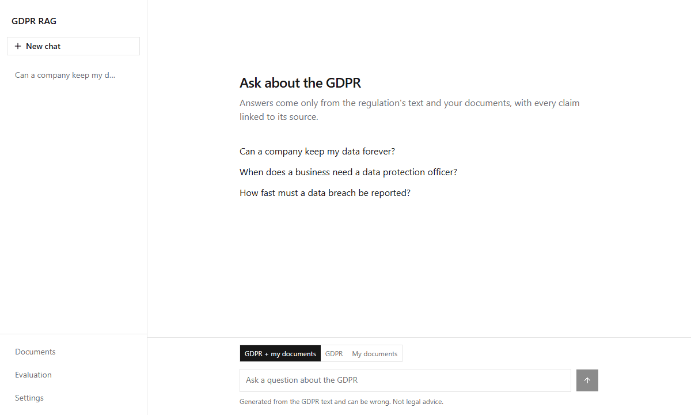
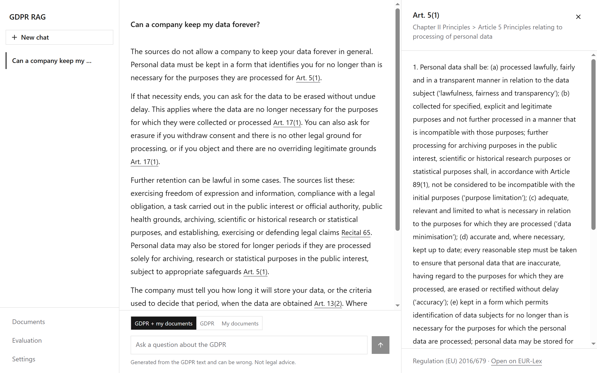
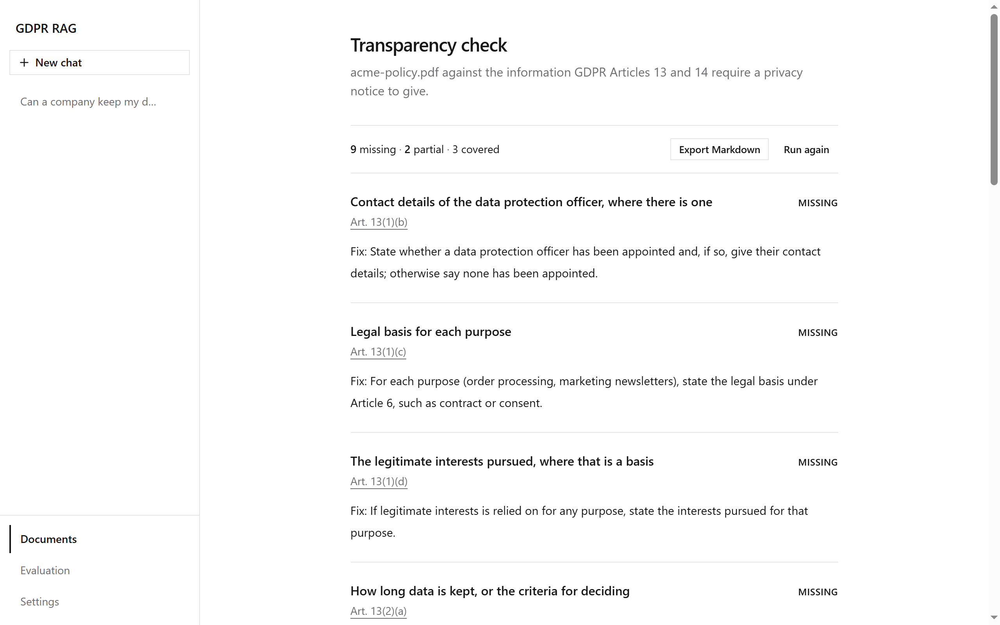
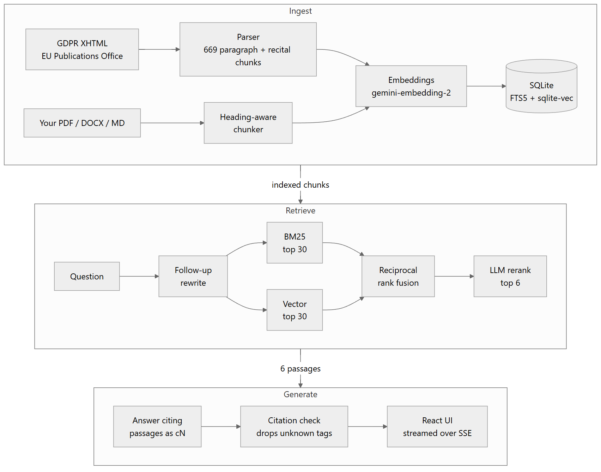

<div align="center">

# gdpr-rag

**Ask the GDPR anything. Every claim links to the article it comes from.**
**Upload a privacy policy and get an Article 13/14 gap report with verbatim evidence.**

[](https://github.com/EFaridRahimli/gdpr-rag/actions/workflows/ci.yml)


[](LICENSE)



</div>

An end-to-end retrieval-augmented generation pipeline over the EU General Data Protection
Regulation, built to be measured rather than demoed. Retrieval, answers and the compliance check
each have an eval; every pipeline choice below was picked by a number, and CI fails if retrieval
regresses. It runs on a laptop: one SQLite file, no Docker, no GPU.

Answers run on your **ChatGPT Plus or Pro plan** through OpenAI's
[Sign in with ChatGPT](https://developers.openai.com/cookbook/articles/sign-in-with-chatgpt), so
there's no per-question bill. Search uses a small [OpenRouter](https://openrouter.ai) key for
embeddings, because ChatGPT plans don't include them.

## Results

| What | Metric | Score |
|---|---|---|
| Retrieval | Right paragraph in the top 5 (50 questions) | **1.00** recall@5, 0.96 MRR |
| Retrieval, held-out | Same, on 30 questions never used to tune anything | **1.00** recall@5, 0.97 MRR |
| Answers | Every claim supported by its cited source (judged by a different model family) | **0.98** faithful, 0.98 citations correct |
| Out-of-scope questions | VAT rates, visas, minimum wage… correctly declined | **10 / 10** |
| Compliance check | Planted gaps found in 3 synthetic policies | **8 / 8**, with 1 of 24 covered items wrongly flagged |

Methodology and the full tables are in [Evaluation](#evaluation), including what these numbers do not show.

## Features

- **Grounded answers.** Answers stream in with `[c1]`-style tags that render as article links.
  The backend drops any citation to a passage that wasn't retrieved, and an answer left without a
  valid citation becomes "not found" instead of a guess.
- **The exact passage, one click away.** Citations open the article paragraph in a side panel,
  with a link to the official text on EUR-Lex.
- **Follow-up questions.** "And what about telling the people affected?" is rewritten into a
  standalone question before retrieval, so it still finds Art. 34.
- **Your documents.** Upload PDF, DOCX, Markdown or text. Search the GDPR, your documents, or both.
- **Compliance check.** A privacy policy is audited against the 14 items Articles 13 and 14
  require: Covered, Partial, Missing or Not applicable, each with quotes and a fix. Quotes are
  checked word for word against the document, so the model can't invent coverage.
- **Runs on your ChatGPT plan.** Sign in once on OpenAI's site; the app never sees your password,
  and you can disconnect it any time in ChatGPT settings.
- **Local and private by default.** Chats, documents and reports live in `data/gdpr.db` on your
  machine. The server only answers on `127.0.0.1`, refuses other sites and DNS-rebinding requests,
  and never returns your key.

<table>
  <tr>
    <td width="50%"></td>
    <td width="50%"></td>
  </tr>
  <tr>
    <td align="center">Cited answer with the source passage open</td>
    <td align="center">Article 13/14 report for an uploaded policy</td>
  </tr>
</table>

## Install

You need a **ChatGPT Plus or Pro** account and an [OpenRouter API key](https://openrouter.ai/keys)
with a little credit (indexing the GDPR costs about $0.03, then a fraction of a cent per question).

### One line (macOS and Linux, nothing pre-installed)

Open Terminal and paste:

```bash
curl -LsSf https://raw.githubusercontent.com/EFaridRahimli/gdpr-rag/main/install.sh | sh
```

It installs [uv](https://docs.astral.sh/uv/) (which brings its own Python), downloads the app to
`~/gdpr-rag`, opens it in your browser, and on macOS puts a **Start GDPR RAG** launcher on the
Desktop for next time. On the Settings page, **sign in with ChatGPT** and **paste your OpenRouter
key**; the GDPR index then builds in the background in about a minute. Running the installer again
updates the app and keeps your chats, documents and settings. Already have a copy? Run
`sh install.sh` inside it instead.

### Manually

Node is not needed; the built frontend is in the repo.

```bash
git clone https://github.com/EFaridRahimli/gdpr-rag && cd gdpr-rag
uv run gdpr-rag serve         # http://localhost:8000, then sign in and add the key in Settings
```

`uv` installs the right Python version and every dependency on first run. The key can also go in
`.env` (`cp .env.example .env`).

## How it works

<p align="center"></p>

<sub>Diagram source: [`docs/architecture.mmd`](docs/architecture.mmd) (Mermaid).</sub>

1. **Chunking.** The GDPR is parsed from the official Journal XHTML into one chunk per article
   paragraph (`Art. 6(1)`) and one per recital. Paragraphs over 350 words, such as the 26
   definitions in Art. 4, are split per lettered point with the lead-in repeated, so every chunk
   is a citable unit. Uploads are split along their headings.
2. **Hybrid retrieval.** FTS5 keyword search (stopwords removed) and sqlite-vec nearest neighbours
   over `gemini-embedding-2` vectors each return 30 candidates, fused with reciprocal rank fusion
   (a few lines, no library).
3. **Reranking.** A fast ChatGPT model (`gpt-6-luna`) picks the 6 most relevant of the 30.
4. **Grounded generation.** `gpt-6.1-sol` sees only those 6 passages and must cite one for every
   sentence. Unknown tags are removed, and an uncited answer becomes "not found".

Models are routed by name: ChatGPT plan models (`gpt-…`) go to OpenAI's Responses API with the
signed-in token; `vendor/model` ids go to OpenRouter. Both answer models can be changed in Settings.

## Evaluation

All eval data is committed in [`eval/`](eval) and every number regenerates with one command.
Questions are generated and answers judged by `claude-sonnet-5.5` (via OpenRouter), a different
model family from the GPT models being measured.

### Retrieval: `uv run gdpr-rag eval retrieval --bakeoff`

50 synthetic questions, each written from one sampled article paragraph. They were not reviewed by
hand: a code check rejects any question that copies 4 or more consecutive words from its passage
(heading included), and a second model pass removes ambiguous, unanswerable or duplicate ones. A
hit means the question's source paragraph is retrieved. Reranking: `gpt-6-luna`.

| Embedding model | Runs | Vector only<br>recall@5 · MRR | **+ LLM rerank**<br>**recall@5 · MRR** |
|---|---|---|---|
| **google/gemini-embedding-2** | **API** | **0.98 · 0.78** | **1.00 · 0.96** |
| mongodb/voyage-4-large | API | 0.92 · 0.77 | 1.00 · 0.95 |
| openai/text-embedding-3-large | API | 0.84 · 0.61 | 0.98 · 0.92 |
| qwen/qwen3-embedding-8b | API | 0.86 · 0.72 | 0.96 · 0.94 |
| Qwen3-Embedding-0.6B | local CPU | 0.44 · 0.34 | 0.82 · 0.79 |
| EmbeddingGemma-300m | local CPU | 0.56 · 0.39 | 0.76 · 0.74 |
| snowflake-arctic-embed-m | local CPU | 0.28 · 0.19 | 0.72 · 0.70 |
| nomic-embed-text-v1.5 | local CPU | 0.24 · 0.10 | 0.62 · 0.57 |
| BM25 keyword search only | — | 0.26 · 0.17 | — |

**Held-out set** (`--set heldout`): 30 questions generated after all tuning, from paragraphs the
main set never used. The default configuration scores **1.00 recall@5, 1.00 recall@10, 0.97 MRR**.

Every row, including hybrid without reranking, is in [`eval/results/retrieval.md`](eval/results/retrieval.md).
CI re-runs vector-only search (it can't sign in to ChatGPT) and fails if any metric drops below
the committed [baseline](eval/baseline.json).

### Answers: `uv run gdpr-rag eval answers`

The 50 questions answered by `gpt-6.1-sol` on a ChatGPT plan, plus 10 out-of-scope questions
([`eval/unanswerable.jsonl`](eval/unanswerable.jsonl)) that should be declined.

| Answered | Expected article cited | Faithful | Citations correct | Out-of-scope declined |
|---|---|---|---|---|
| 1.00 | 0.98 | 0.98 | 0.98 | 10 / 10 |

The one unfaithful answer turned a "may" in Art. 49 into a "must".

### Compliance check: `uv run gdpr-rag eval compliance`

Three hand-written policies (a fitness app, an online store, a recruiting platform) with 8
deliberately planted gaps, such as no right to complain, US transfers without safeguards, and
automated ranking with no explanation. The answer key in
[`eval/policies/truth.json`](eval/policies/truth.json) scores only unambiguous items.

| Planted gaps found | Covered items wrongly flagged |
|---|---|
| 8 / 8 | 1 / 24 |

The one false alarm (Brightside's retention period) is borderline: the policy never says how long
heart-rate data is kept.

### What these numbers don't show

- **The retrieval set is easy at the top.** The best configurations score 1.00, so 50 questions
  can't separate them, and every question targets a single paragraph. Questions that need several
  articles at once aren't measured.
- **Synthetic questions favour vector search.** Banning copied phrases starves BM25 by
  construction. Real users type terms like "Article 17" or "DPO", where keyword search helps,
  which is why hybrid search stays in the pipeline.
- **The citation check is structural.** It guarantees every citation points to a retrieved
  passage, not that the passage supports the sentence. The faithfulness score above measures that
  part; the app doesn't re-verify each answer at runtime.
- **LLM judges are noisy.** Expect a point or two of variation between answer-eval runs.
- **Three policies is a small compliance set.** It shows the check works, not how often it's
  right on real-world policies.
- **The held-out answer eval** hasn't been run yet (held-out retrieval has).

## Design decisions

| Decision | Alternative considered | Why |
|---|---|---|
| GPT-6.1-Sol answers on a ChatGPT plan | Claude Haiku 5.5 via OpenRouter | 0.98 vs 0.86 faithfulness on the same retrieval (Haiku: single run), and no per-question bill for Plus/Pro users |
| Sign in with ChatGPT | Claude subscription tokens | OpenAI allows plan usage in open-source, locally run apps; Anthropic's terms forbid routing Pro/Max credentials through third-party apps |
| LLM reranking (`gpt-6-luna`) | Local cross-encoder (`jina-reranker-v1-tiny-en`) | 1.00 vs ~0.24 recall@5: the tiny model's scores were too close together to rank paraphrased questions |
| `gemini-embedding-2` via OpenRouter | Local embeddings (4 models measured) | Best local model reached 0.82 recall@5 even with reranking, vs 1.00; ChatGPT plans don't allow embeddings |
| `gemini-embedding-2` | Voyage-4-large, Qwen3-8B, OpenAI 3-large | Tied with Voyage after reranking, and best without it (0.98 recall@5), so it is the safer fallback |
| One SQLite file | Vector database server | ~670 chunks fit easily. FTS5, vectors, chats and settings live in one file with nothing to run |
| Citation check in code | Trusting the model's tags | A citation to an unretrieved passage can't reach the user. An uncited answer becomes "not found" |
| Quote check in code | Trusting the auditor model | Coverage without a verbatim quote is downgraded to Missing |
| Built frontend committed | Node required at install | Users only need `uv`. CI rebuilds and fails if the committed build is stale |

The full design record, including the questions settled before any code was written, is in [SPEC.md](SPEC.md).

## Security

The app is local-only but treats the browser as a hostile environment:

- **No cross-site use of the local API.** Requests whose `Host` isn't `localhost`/`127.0.0.1`
  (DNS rebinding) and writes from other sites (`Origin`, `Sec-Fetch-Site`) are refused, so a web
  page can't swap your key, read your chats or spend your credit.
- **No exfiltration through answers.** Model output is rendered without images, and a Content
  Security Policy blocks remote images as a second layer, so a poisoned uploaded document can't
  make the browser leak the conversation in an image URL.
- **Sign in with ChatGPT** uses PKCE with single-use, expiring state; the identity token's issuer,
  audience and nonce are checked, and sign-out revokes the session with OpenAI.
- Keys and ChatGPT tokens stay in `data/gdpr.db` on your machine and are never returned by the API.

## Development

```bash
uv run pytest                          # backend tests
uv run ruff check .                    # lint
cd web && npm install && npm run dev   # frontend on :5173, proxied to `gdpr-rag serve`
npm run lint && npm run build          # lint, typecheck and rebuild web/dist (commit the result)
```

| Path | Contents |
|---|---|
| `src/gdpr_rag/gdpr.py` | GDPR download and paragraph-level chunking |
| `src/gdpr_rag/store.py` | SQLite schema, FTS5 and sqlite-vec search, scope filters |
| `src/gdpr_rag/retrieve.py` | Hybrid retrieval, RRF, reranking |
| `src/gdpr_rag/answer.py` | Grounded prompt, citation check, follow-up rewriting |
| `src/gdpr_rag/llm.py` | Model routing: ChatGPT plan (Responses API) or OpenRouter |
| `src/gdpr_rag/chatgpt.py` | Sign in with ChatGPT: OAuth + PKCE, token refresh, sign-out |
| `src/gdpr_rag/ingest.py` | Building the GDPR index (CLI and background) |
| `src/gdpr_rag/docs.py` | Upload parsing and heading-aware chunking |
| `src/gdpr_rag/compliance.py` | Article 13/14 checklist and quote verification |
| `src/gdpr_rag/evals.py` | Question generation and all evals |
| `src/gdpr_rag/server.py` | FastAPI app: streaming chat, documents, reports, settings, security middleware |
| `web/src/` | React + TypeScript UI (shadcn/ui on Radix) |

Settings saved in the app win; otherwise they come from the environment: `OPENROUTER_MODEL`
(answers, default `gpt-6.1-sol`; a `vendor/model` id uses OpenRouter instead), `FAST_MODEL`
(reranking and follow-ups, default `gpt-6-luna`), `EMBED_MODEL`, `EVAL_MODEL` (question generation
and judging, default `anthropic/claude-sonnet-5.5`) and `OPENROUTER_RPM` for eval rate limiting.

## Limitations

- Needs ChatGPT Plus or Pro for answers; Sign in with ChatGPT is a trial programme at OpenAI and
  may change. Requests count toward your plan's limits.
- English only, and the GDPR text only. EDPB guidelines and national laws aren't included.
- Scanned PDFs are rejected; there is no OCR. Policies over 40,000 words aren't supported.
- Uploaded text is sent to OpenRouter for embedding and to OpenAI for answering.
- **Not legal advice.** Answers and reports are generated by language models and can be wrong.

## License

[AGPL-3.0](LICENSE), required by the PDF parser
([pymupdf4llm](https://github.com/pymupdf/pymupdf4llm)). The GDPR text is © European Union,
reused under Commission Decision 2011/833/EU on the reuse of Commission documents. Sign in with
ChatGPT is an independent implementation of OpenAI's documented protocol; no code from OpenAI's
noncommercially licensed devkit is included.
